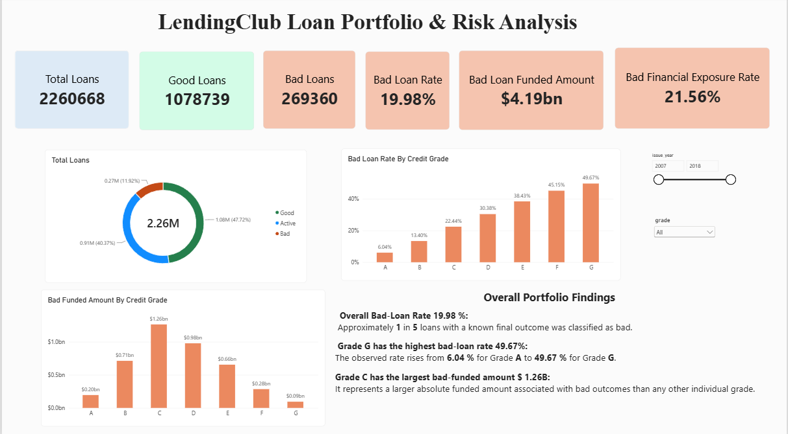
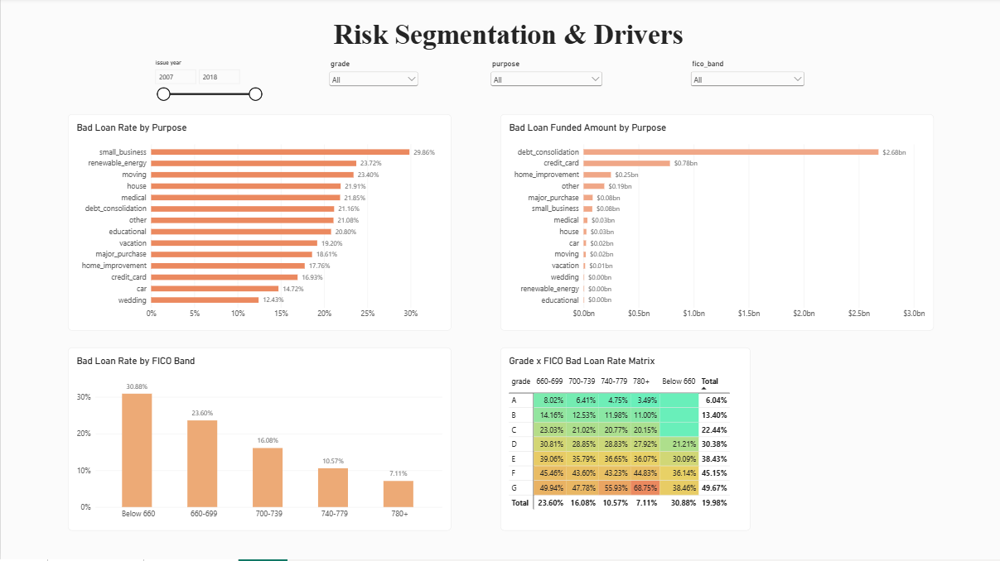
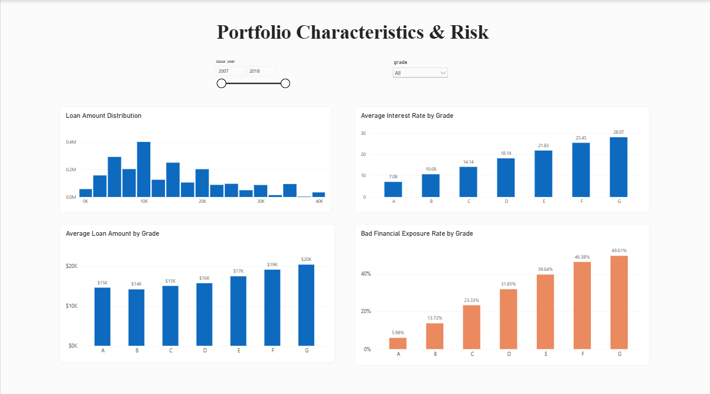

# LendingClub Loan Portfolio & Risk Analysis

## 1. Project Overview

This project analyzes LendingClub loan data to evaluate portfolio performance, identify patterns in bad-loan rates, and examine where funded amounts associated with bad outcomes are concentrated.

Using SQL, Python, and Power BI, the analysis explores credit-grade risk, borrower FICO scores, loan purposes, and financial exposure to support data-driven portfolio risk assessment.

## 2. Business Problem

The objective is to understand how observed loan outcomes vary across borrower and loan characteristics and identify segments with elevated bad-loan rates or significant financial exposure.

**Key business question:**

Which borrower and loan characteristics are associated with higher bad-loan rates, and where is the lending portfolio most financially exposed to bad loan outcomes?

## 3. Dataset

- **Source:** LendingClub loan dataset ([https://www.kaggle.com/datasets/wordsforthewise/lending-club])
- **Period covered:** 2007–2018
- **Records analyzed:** 2,260,668 loans
- **Original dataset:** 151 columns
- **Prepared dataset:** 34 selected columns

The analysis uses loan, borrower, credit-grade, FICO-score, interest-rate, loan-purpose, and loan-outcome information.

The original dataset is not included in this repository because of its large file size.

## 4. Tools and Technologies

- **SQL (MySQL):** Data exploration, aggregation, joins, window functions, and risk segmentation
- **Python (pandas):** Data preparation and cleaning
- **Power BI:** Interactive dashboards and visual analysis
- **Power Query:** Data transformation and calculated fields
- **Git and GitHub:** Version control and project documentation

## 5. Data Preparation and Methodology

- Removed non-loan summary/footer rows from the source data.
- Selected and prepared 34 relevant columns for analysis.
- Classified loan outcomes into Good, Bad, and Active categories.
- Created FICO-score bands and derived issue-year information for segmentation.
- Calculated bad-loan rates using loans with known outcomes only.

### Loan Outcome Definitions

- **Good:** Fully Paid and policy-exception Fully Paid loans.
- **Bad:** Charged Off, Default, and policy-exception Charged Off loans.
- **Active:** Current, Late (16–30 days), Late (31–120 days), and In Grace Period loans.

Active loans are excluded from the bad-loan-rate denominator because their final outcomes are not yet known.

**Bad-loan rate = Bad loans ÷ (Good loans + Bad loans) × 100**

## 6. SQL Analysis

Eight SQL analyses were performed to investigate the following business questions:

1. How are loans distributed across different loan statuses?
2. What is the overall bad-loan rate among loans with known outcomes?
3. How does the bad-loan rate vary across credit grades?
4. Which sub-grades show elevated bad-loan rates with meaningful loan volume?
5. Where is the portfolio most financially exposed to bad loan outcomes?
6. How does borrower credit score relate to bad-loan rates?
7. How do loan purposes differ in bad-loan rates and financial exposure?
8. Which grade–FICO combinations have elevated risk, meaningful volume, and significant exposure?

See the `sql/` directory for the corresponding queries.

## 7. Power BI Dashboard

The interactive dashboard contains three pages:

### Page 1 — LendingClub Loan Portfolio and Risk Analysis

Summarizes overall portfolio performance through loan outcome distribution, key performance indicators, bad-loan rates by grade, and bad funded amounts by grade.




### Page 2 — Credit Risk Segmentation & Drivers

Examines differences in bad-loan rates and financial exposure across loan purposes, FICO bands, and grade–FICO combinations.



### Page 3 — Portfolio Characteristics & Risk

Explores loan amount distribution, average interest rates, average loan amounts, and bad financial exposure rates across credit grades.



## 8. Key Findings

### Portfolio performance

- Of 2,260,668 loans, 1,348,099 (59.6%) have a known outcome: 1,078,739 good and 269,360 bad. The remaining ~40% are still active and excluded from rate calculations.
- The overall bad-loan rate is **19.98%**, roughly 1 in 5 loans with a known outcome.
- Bad loans account for **$4.19bn of $19.41bn** funded on known-outcome loans, a **21.56%** bad financial exposure rate. This is above the loan-count rate, meaning bad loans are larger than average.

### Credit-grade risk

Bad-loan rate rises at every grade step, from **6.04% (Grade A) to 49.67% (Grade G)**, about an 8x spread.

| Grade | Bad-loan rate | Bad exposure rate | Bad funded amount | Avg. interest rate |
|---|---|---|---|---|
| A | 6.04% | 5.98% | $0.20bn | 7.08% |
| B | 13.40% | 13.72% | $0.71bn | 10.68% |
| C | 22.44% | 23.33% | $1.26bn | 14.14% |
| D | 30.38% | 31.85% | $0.98bn | 18.14% |
| E | 38.43% | 39.64% | $0.66bn | 21.83% |
| F | 45.15% | 46.38% | $0.28bn | 25.45% |
| G | 49.67% | 49.61% | $0.09bn | 28.07% |

- Risk continues to rise inside grades. Among sub-grades with more than 10,000 known-outcome loans, E5 is highest at 41.55%, and all D and E sub-grades plus C2–C5 exceed the 19.98% portfolio average.
- Interest rates rise with grade but more slowly than bad-loan rates (Grade G: 28.07% average rate against a 49.67% bad-loan rate).

### Financial exposure

- **Grade C holds the largest bad funded amount ($1.26bn)**, followed by D ($0.98bn), B ($0.71bn) and E ($0.66bn).
- Exposure follows volume as well as rate: Grade B (13.40% rate) carries more bad funded dollars than Grade E (38.43% rate), and Grades F and G together total only about $0.37bn despite the highest rates.
- The largest sub-grade exposures are C4 ($286.1M), C5 ($272.1M), C3 ($248.7M) and C2 ($232.3M).

### Credit-score segmentation

| FICO band | Known-outcome loans | Bad-loan rate |
|---|---|---|
| Below 660 | 489 | 30.88% |
| 660–699 | 822,224 | 23.60% |
| 700–739 | 380,014 | 16.08% |
| 740–779 | 107,034 | 10.57% |
| 780+ | 38,338 | 7.11% |

- Bad-loan rate falls consistently as FICO rises, from 23.60% (660–699) to 7.11% (780+).
- The 660–699 band contains about 61% of all known-outcome loans.
- The Below 660 band has only 489 loans, so its rate should be interpreted cautiously.

### Loan purpose

- **Small business** has the highest bad-loan rate (**29.86%**) and exposure rate (32.57%), but only about $79M in bad funded amount (~2% of the total).
- **Debt consolidation** accounts for **$2.68bn (~64%)** of all bad funded dollars, driven by volume (781,442 known-outcome loans) rather than rate (21.16%).
- Credit card refinancing adds $784M (~19%), so these two purposes together represent roughly **83%** of bad funded amounts.
- Lowest-risk purposes: wedding (12.43%), car (14.72%) and credit card (16.93%).

### Grade–FICO segmentation

- Three segments, **Grades C, D and E in the 660–699 FICO band**, hold about **$2.14bn (~51%)** of all bad funded dollars:

| Segment | Bad-loan rate | Bad funded amount |
|-------- | ------------- |-----------------  |
| C, 660–699 | 23.03% | $866.2M |
| D, 660–699 | 30.81% | $749.6M |
| E, 660–699 | 39.06% | $523.4M |

- Credit grades shows a larger observed risk difference than FICO bands in the segments compared. Within a grade, moving from the lowest to the highest FICO band changes the rate by only a few points (Grade A: 8.02% to 3.49%; Grade C: 23.03% to 20.15%), while moving between grades changes it by 7–15 points.
- High FICO does not offset a weak grade: Grade C borrowers at 780+ still show a 20.15% bad-loan rate, above the portfolio average.

## 9. Business Recommendations

- Investigate higher-risk credit grades and sub-grades to understand the borrower and loan characteristics associated with their elevated bad-loan rates.
- Prioritize portfolio monitoring using both bad-loan rates and bad funded amounts, rather than relying on rates alone.
- Review loan-purpose and grade–FICO segments with elevated risk and substantial exposure.
- Validate findings against loan vintage, recovery, and loss data before making lending-policy decisions.

## 10. Limitations

- Active loans were excluded from the bad-loan-rate calculation because their final outcomes were unknown at the time of analysis.
- Funded amounts associated with bad outcomes represent exposure measures, not actual realized losses or unrecovered principal.
- Some segments, particularly the lowest FICO band, contain relatively few loans and should be interpreted cautiously.
- The analysis identifies associations and patterns; it does not establish that borrower or loan characteristics caused bad outcomes.
- Differences across loan issue years and other borrower characteristics may influence comparisons.

## 11. Repository Structure

```text
### Repository Structure

```text
lendingclub-loan-risk-analysis/
├── README.md
├── .gitignore
├── sql/                  # SQL analysis and business questions
├── python/               # Python scripts for data preparation              
└── screenshots/          # Dashboard screenshots
```

### Data Availability

The raw LendingClub datasets are excluded from this repository to avoid uploading large CSV files. The `.gitignore` file excludes CSV datasets stored directly in the `data/` directory, along with Python cache files, virtual environments, and temporary files.

The analysis can be reproduced using the relevant source dataset from LendingClub, subject to its availability and applicable data-use terms.


```

## 12. Conclusion

This project demonstrates how SQL-based analysis and interactive Power BI reporting can be used to evaluate loan portfolio performance, compare observed credit risk across segments, and identify concentrations of funded amounts associated with bad outcomes.